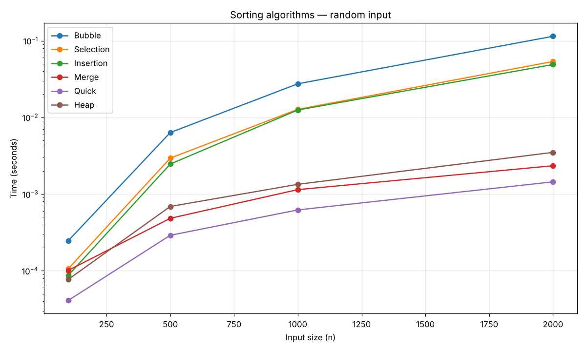
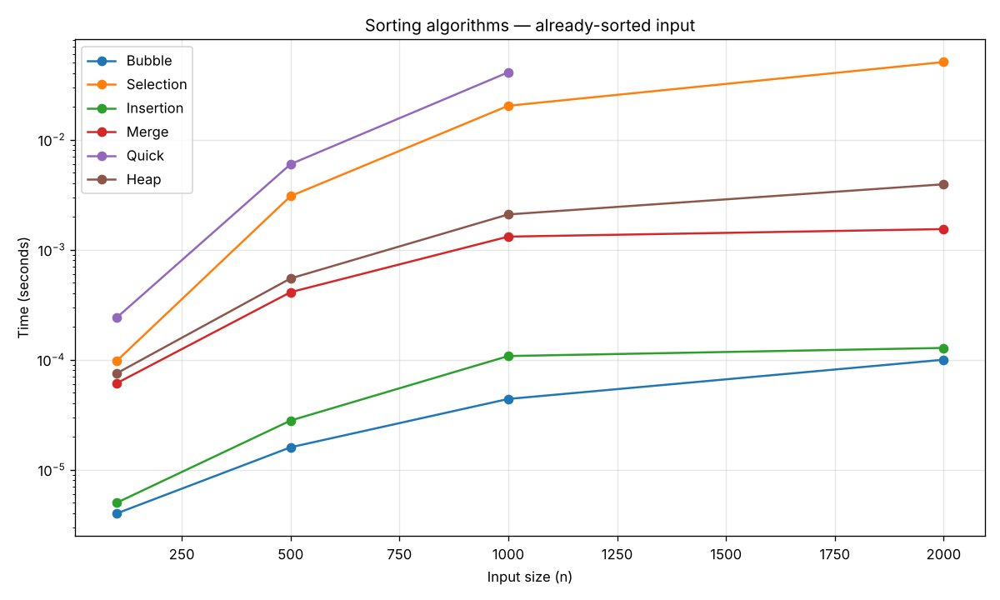

# DAA Lab Task 3 — Comprehensive Lab Report & Structured Documentation

**Course:** Design and Analysis of Algorithms Lab
**Lab Task:** Task 3 (Sorting Algorithms, Binary Search, Hashing, Empirical Timing & Applications)

---

## Directory Structure

The repository is organized as a flat lab folder with programs numbered to match the assignment specification:

```
DAA-LAB-TASK-3/
├── README.md                              # Master documentation & complete lab report
│
├── program1_basic_sorts.py                # Bubble Sort, Selection Sort, Insertion Sort
├── program2_advanced_sorts.py             # Merge Sort, Quick Sort (last element pivot), Heap Sort
├── program3_radix_sort.py                 # Radix Sort (LSD approach with Counting Sort)
├── program4_binary_search.py              # Iterative Binary Search (present & absent cases)
│
├── program5_timing_analysis.py            # Empirical timing on random, sorted, reverse inputs
├── program6_graphing.py                   # Matplotlib plotting script
├── timing_results.csv                     # Raw timing dataset (N = 100, 500, 1000, 2000)
├── graph_random.png                       # Graph: Performance on Random Input
├── graph_sorted.png                       # Graph: Performance on Already-Sorted Input
│
├── program7_student_manager.py            # Student Record Manager (sorting, search, benchmarks)
└── program8_search_engine.py              # Search Engine Simulator (binary search vs hash tables)
```

---

## Table of Contents
1. [Section A: Concept Check](#section-a-concept-check)
2. [Section B: Trace the Logic](#section-b-trace-the-logic)
3. [Section C: Programs to Write (Programs 1–4)](#section-c-programs-to-write)
   - [Program 1: Bubble, Selection, and Insertion Sort](#program-1-bubble-selection-and-insertion-sort)
   - [Program 2: Merge, Quick, and Heap Sort](#program-2-merge-quick-and-heap-sort)
   - [Program 3: Radix Sort (LSD Approach)](#program-3-radix-sort-lsd-approach)
   - [Program 4: Iterative Binary Search](#program-4-iterative-binary-search)
4. [Section D: Empirical Timing Analysis (Programs 5–6)](#section-d-empirical-timing-analysis)
   - [Program 5: Sorting Algorithm Comparison](#program-5-sorting-algorithm-comparison)
   - [Program 6: Graphing the Results](#program-6-graphing-the-results)
5. [Section E: Applications (Programs 7–8)](#section-e-applications)
   - [Program 7: Student Record Manager](#program-7-student-record-manager)
   - [Program 8: Search Engine Simulator](#program-8-search-engine-simulator)
6. [Section F: In-Depth Analysis](#section-f-analysis)
7. [How to Run All Programs](#how-to-run-all-programs)

---

# Section A: Concept Check

1. Bubble sort works by repeatedly swapping **adjacent** elements if they are in the wrong order.
2. Selection sort repeatedly finds the **minimum** (or **smallest**) element from the unsorted part and places it at the beginning.
3. Insertion sort builds the sorted portion one element at a time by **inserting** each new element into its correct position.
4. Merge sort follows a **divide** and **conquer** approach: split the array, sort each half, then combine.
5. Quick sort picks a **pivot** and partitions the array around it before recursing.
6. Heap sort relies on a data structure called a **heap** (or **binary heap** / **max-heap**), which is typically implemented using an array.
7. Radix sort processes numbers digit by digit, starting from the **least** significant digit (in the standard LSD version).
8. Binary search requires the input array to be **sorted** before it can be used.
9. In hashing, when two different keys map to the same index, this is called a **collision**.
10. Separate chaining resolves collisions by storing multiple values at the same index using a **linked list** (or **chain**), while linear probing resolves them by **searching for the next available/open slot sequentially** (probing `(index + 1) % table_size`).

---

# Section B: Trace the Logic

### 1. Trace Bubble Sort on `[5, 2, 8, 1, 9]` for One Full Pass
- **Initial Array:** `[5, 2, 8, 1, 9]` ($n = 5$)
- **Comparison 1:** Compare `arr[0]` (5) and `arr[1]` (2). Since $5 > 2$, **swap**.
  **Array after Swap 1:** `[2, 5, 8, 1, 9]`
- **Comparison 2:** Compare `arr[1]` (5) and `arr[2]` (8). Since $5 < 8$, no swap.
  Array remains: `[2, 5, 8, 1, 9]`
- **Comparison 3:** Compare `arr[2]` (8) and `arr[3]` (1). Since $8 > 1$, **swap**.
  **Array after Swap 2:** `[2, 5, 1, 8, 9]`
- **Comparison 4:** Compare `arr[3]` (8) and `arr[4]` (9). Since $8 < 9$, no swap.
  Array remains: `[2, 5, 1, 8, 9]`
- **Final Array after 1 Full Pass:** `[2, 5, 1, 8, 9]` (largest element 9 placed in its final position).

---

### 2. Trace Selection Sort on `[5, 2, 8, 1, 9]` (4 Selection-and-Swap Steps)
- **Initial Array:** `[5, 2, 8, 1, 9]`
- **Step 1 ($i = 0$):** Unsorted range `[5, 2, 8, 1, 9]`. Minimum is `1` at index 3. Swap `arr[0]` (5) and `arr[3]` (1).
  **Array after Step 1:** `[1, 2, 8, 5, 9]`
- **Step 2 ($i = 1$):** Unsorted range `[2, 8, 5, 9]`. Minimum is `2` at index 1. Swap with itself.
  **Array after Step 2:** `[1, 2, 8, 5, 9]`
- **Step 3 ($i = 2$):** Unsorted range `[8, 5, 9]`. Minimum is `5` at index 3. Swap `arr[2]` (8) and `arr[3]` (5).
  **Array after Step 3:** `[1, 2, 5, 8, 9]`
- **Step 4 ($i = 3$):** Unsorted range `[8, 9]`. Minimum is `8` at index 3. Swap with itself.
  **Array after Step 4:** `[1, 2, 5, 8, 9]`
- **Final Sorted Array:** `[1, 2, 5, 8, 9]`

---

### 3. Trace Insertion Sort on `[5, 2, 8, 1, 9]`
- **Initial Array:** `[5, 2, 8, 1, 9]` (Sorted portion: `[5]`)
- **Step 1 (Insert 2):** $2 < 5 \rightarrow$ shift 5 to index 1, place 2 at index 0.
  **Array:** `[2, 5, 8, 1, 9]` (Sorted: `[2, 5]`)
- **Step 2 (Insert 8):** $8 > 5 \rightarrow$ remains at index 2.
  **Array:** `[2, 5, 8, 1, 9]` (Sorted: `[2, 5, 8]`)
- **Step 3 (Insert 1):** Shift 8, shift 5, shift 2, place 1 at index 0.
  **Array:** `[1, 2, 5, 8, 9]` (Sorted: `[1, 2, 5, 8]`)
- **Step 4 (Insert 9):** $9 > 8 \rightarrow$ remains at index 4.
  **Array:** `[1, 2, 5, 8, 9]` (Sorted: `[1, 2, 5, 8, 9]`)
- **Final Sorted Array:** `[1, 2, 5, 8, 9]`

---

### 4. Trace Merge Sort's Splitting Step on `[8, 3, 5, 4, 7, 6, 1, 2]`
```
Original Array:
  [8, 3, 5, 4, 7, 6, 1, 2]

Level 1 Splits:
  Left:  [8, 3, 5, 4]
  Right: [7, 6, 1, 2]

Level 2 Splits:
  From [8, 3, 5, 4] -> [8, 3] and [5, 4]
  From [7, 6, 1, 2] -> [7, 6] and [1, 2]

Level 3 Splits (Base cases - single elements):
  From [8, 3] -> [8], [3]
  From [5, 4] -> [5], [4]
  From [7, 6] -> [7], [6]
  From [1, 2] -> [1], [2]
```
**All Produced Subarrays:**
- Level 1: `[8, 3, 5, 4]`, `[7, 6, 1, 2]`
- Level 2: `[8, 3]`, `[5, 4]`, `[7, 6]`, `[1, 2]`
- Level 3: `[8]`, `[3]`, `[5]`, `[4]`, `[7]`, `[6]`, `[1]`, `[2]`

---

### 5. Trace Quick Sort's First Partition Step on `[8, 3, 5, 4, 7, 6, 1, 2]`
- **Pivot:** Last element $\rightarrow \text{pivot} = arr[7] = 2$.
- **Pointers:** `low = 0`, `high = 7`, $i = -1$.
- Scan $j = 0$ to $6$:
  - $j = 0$ (val 8), $j=1$ (val 3), $j=2$ (val 5), $j=3$ (val 4), $j=4$ (val 7), $j=5$ (val 6): all $> 2$, no swap.
  - $j = 6$ (val 1): $1 \le 2 \rightarrow i$ becomes 0. Swap `arr[0]` (8) and `arr[6]` (1).
    Array: `[1, 3, 5, 4, 7, 6, 8, 2]`
- **Place Pivot:** Swap `arr[i + 1]` (`arr[1] = 3`) with `arr[7]` (2).
- **Array after partition:** `[1, 2, 5, 4, 7, 6, 8, 3]`
- **Pivot's Final Index:** **1**
  (Left subarray `[1]` has elements $\le 2$; Right subarray `[5, 4, 7, 6, 8, 3]` has elements $> 2$).

---

### 6. Trace Radix Sort on `[170, 45, 75, 90, 802, 24, 2, 66]`
1. **After Sorting by Ones Digit ($num \% 10$):**
   Digits: $170\to0$, $45\to5$, $75\to5$, $90\to0$, $802\to2$, $24\to4$, $2\to2$, $66\to6$.
   Stable arrangement: `[170, 90, 802, 2, 24, 45, 75, 66]`

2. **After Sorting by Tens Digit ($(num // 10) \% 10$):**
   Digits: $170\to7$, $90\to9$, $802\to0$, $2\to0$, $24\to2$, $45\to4$, $75\to7$, $66\to6$.
   Stable arrangement: `[802, 2, 24, 45, 66, 170, 75, 90]`

---

### 7. Trace Binary Search for Value 23 on Sorted Array
**Array:** `[2, 5, 8, 12, 16, 23, 38, 45, 56, 72, 91]` ($N=11$), Target = `23`.

| Step | `low` | `high` | `mid` | `arr[mid]` | Observation |
| :---: | :---: | :---: | :---: | :---: | :--- |
| **1** | **0** | **10** | **5** | **23** | `arr[5] == 23` $\rightarrow$ Target found at index **5** in **1 comparison**! |

---

### 8. Separate Chaining Hash Table (Size 7, $h(key) = key \% 7$)
Keys inserted in order: `10, 3, 17, 24, 9`
- $10 \pmod 7 = 3 \rightarrow$ Slot 3: `[10]` (No collision)
- $3 \pmod 7 = 3 \rightarrow$ Slot 3: `[10 -> 3]` (**Collision** with 10)
- $17 \pmod 7 = 3 \rightarrow$ Slot 3: `[10 -> 3 -> 17]` (**Collision** with 10, 3)
- $24 \pmod 7 = 3 \rightarrow$ Slot 3: `[10 -> 3 -> 17 -> 24]` (**Collision** with 10, 3, 17)
- $9 \pmod 7 = 2 \rightarrow$ Slot 2: `[9]` (No collision)

**Final Table (Chaining):**
- Slot 0: `Empty`
- Slot 1: `Empty`
- Slot 2: `[9]`
- Slot 3: `[10 -> 3 -> 17 -> 24]`
- Slot 4: `Empty`
- Slot 5: `Empty`
- Slot 6: `Empty`

---

### 9. Linear Probing Hash Table (Size 7, $h(key) = key \% 7$)
Keys inserted in order: `10, 3, 17, 24, 9`
- Key 10: $10 \pmod 7 = 3 \rightarrow$ Slot 3 empty $\rightarrow$ **Place 10 at Index 3**.
- Key 3: $3 \pmod 7 = 3 \rightarrow$ Slot 3 taken. Probe 4 empty $\rightarrow$ **Place 3 at Index 4**.
- Key 17: $17 \pmod 7 = 3 \rightarrow$ Slot 3 taken. Probe 4 taken. Probe 5 empty $\rightarrow$ **Place 17 at Index 5**.
- Key 24: $24 \pmod 7 = 3 \rightarrow$ Slots 3, 4, 5 taken. Probe 6 empty $\rightarrow$ **Place 24 at Index 6**.
- Key 9: $9 \pmod 7 = 2 \rightarrow$ Slot 2 empty $\rightarrow$ **Place 9 at Index 2**.

**Final Indices:** Key 9 $\to$ **2**, Key 10 $\to$ **3**, Key 3 $\to$ **4**, Key 17 $\to$ **5**, Key 24 $\to$ **6**.

---

# Section C: Programs to Write

All algorithms return a sorted list (functional style — each takes a list and returns a new sorted list, leaving the input untouched for reproducible testing).

---

### Program 1: Bubble, Selection, and Insertion Sort
- **File:** [`program1_basic_sorts.py`](program1_basic_sorts.py)
- **Aim:** Implement standalone functions for Bubble Sort, Selection Sort, and Insertion Sort, printing the array state after each pass/step via a `verbose=True` flag.
- **Logic:** Bubble sort swaps inverted adjacent elements with early termination if a pass has zero swaps. Selection sort finds the minimum in the remaining unsorted suffix and swaps it to the front. Insertion sort shifts elements greater than the active key one position right to place the key in its sorted prefix.
- **Sample Input Tested:** `[5, 2, 8, 1, 9, 3, 7, 4, 6]`
- **Sample Output:** Output demonstrates step-by-step sorting for each algorithm and terminates in `[1, 2, 3, 4, 5, 6, 7, 8, 9]`.

---

### Program 2: Merge, Quick, and Heap Sort
- **File:** [`program2_advanced_sorts.py`](program2_advanced_sorts.py)
- **Aim:** Implement standalone functions for Merge Sort, Quick Sort (commenting pivot strategy), and Heap Sort.
- **Pivot Strategy Used:** **Last Element (`pivot = arr[high]`)**. This is a deliberate choice: it produces the pathological $O(n^2)$ worst-case behaviour on already-sorted input, which is directly observable in the Section D timing data and explained in the Section F analysis.
- **Logic:** Merge sort divides recursively at the midpoint and merges back in sorted order. Quick sort partitions using Lomuto's scheme with the last element pivot and recurses on left and right subranges. Heap sort builds a max-heap in-place via bottom-up heapification, extracting the root element repeatedly to the end.
- **Sample Input Tested:** `[8, 3, 5, 4, 7, 6, 1, 2]`
- **Sample Output:** All three produce sorted array `[1, 2, 3, 4, 5, 6, 7, 8]`.

---

### Program 3: Radix Sort (LSD Approach)
- **File:** [`program3_radix_sort.py`](program3_radix_sort.py)
- **Aim:** Implement Radix Sort for non-negative integers using the Least Significant Digit (LSD) approach and a stable Counting Sort helper for individual digit positions.
- **Logic:** Determines the maximum value to find digit count ($d$). Uses a stable counting sort subroutine that tallies digit counts ($0-9$) at the active exponent ($10^i$), builds prefix sums, and populates the output buffer in reverse order to preserve relative ordering.
- **Sample Input Tested:** `[170, 45, 75, 90, 802, 24, 2, 66]`
- **Sample Output:** `[2, 24, 45, 66, 75, 90, 170, 802]`.

---

### Program 4: Iterative Binary Search
- **File:** [`program4_binary_search.py`](program4_binary_search.py)
- **Aim:** Implement iterative binary search on a sorted list returning the index of the target or -1 if absent.
- **Logic:** Maintains search window bounds `low` and `high`, inspecting the middle element `mid = (low + high) // 2`. Narrows search window to left or right subrange iteratively until match is found or window becomes invalid.
- **Sample Input Tested:** `[2, 5, 8, 12, 16, 23, 38, 45, 56, 72, 91]`
- **Sample Output:**
  - Target 23: Found at index 5 in 1 comparison.
  - Target 50: Not found (returns -1).

---

# Section D: Empirical Timing Analysis

### Program 5: Sorting Algorithm Comparison
- **File:** [`program5_timing_analysis.py`](program5_timing_analysis.py)
- **Aim:** Benchmark all six comparison-based sorting algorithms across three input distributions (random, already-sorted, reverse-sorted) at four array sizes ($N = 100, 500, 1000, 2000$), persist the results to `timing_results.csv`, and print a formatted results table.
- **Logic:** Each input is generated once with a fixed random seed for reproducibility. Each sort is timed with `time.perf_counter()` on a fresh copy of the input. Quick Sort is skipped at $N = 2000$ on sorted/reversed inputs because the last-element pivot triggers recursion-depth exhaustion — this is itself a core finding of the lab and is discussed in Section F.

#### Timing Tables (grouped by input distribution)

##### 1. Random Order Input (Average Case)
| Algorithm | N = 100 | N = 500 | N = 1000 | N = 2000 |
| :--- | :---: | :---: | :---: | :---: |
| **Bubble Sort** | 0.246 ms | 6.347 ms | 27.449 ms | 114.246 ms |
| **Selection Sort** | 0.106 ms | 2.945 ms | 12.738 ms | 53.593 ms |
| **Insertion Sort** | 0.087 ms | 2.464 ms | 12.494 ms | 48.946 ms |
| **Merge Sort** | 0.101 ms | 0.483 ms | 1.143 ms | 2.341 ms |
| **Quick Sort** | **0.041 ms** | **0.290 ms** | **0.621 ms** | **1.444 ms** |
| **Heap Sort** | 0.077 ms | 0.689 ms | 1.341 ms | 3.497 ms |

##### 2. Already-Sorted Input (Best vs Worst Case Divergence)
| Algorithm | N = 100 | N = 500 | N = 1000 | N = 2000 |
| :--- | :---: | :---: | :---: | :---: |
| **Bubble Sort** | **0.004 ms** | **0.016 ms** | **0.044 ms** | **0.100 ms** |
| **Selection Sort** | 0.097 ms | 3.068 ms | 20.318 ms | 50.716 ms |
| **Insertion Sort** | **0.005 ms** | **0.028 ms** | **0.108 ms** | **0.128 ms** |
| **Merge Sort** | 0.061 ms | 0.411 ms | 1.314 ms | 1.539 ms |
| **Quick Sort** | 0.240 ms | 5.990 ms | 40.948 ms | *skipped (recursion depth)* |
| **Heap Sort** | 0.075 ms | 0.548 ms | 2.091 ms | 3.930 ms |

##### 3. Reverse-Sorted Input (Worst Case for Elementary Sorts)
| Algorithm | N = 100 | N = 500 | N = 1000 | N = 2000 |
| :--- | :---: | :---: | :---: | :---: |
| **Bubble Sort** | 0.253 ms | 8.400 ms | 33.676 ms | 157.778 ms |
| **Selection Sort** | 0.107 ms | 4.469 ms | 13.046 ms | 53.141 ms |
| **Insertion Sort** | 0.159 ms | 7.657 ms | 20.976 ms | 71.707 ms |
| **Merge Sort** | **0.063 ms** | **0.355 ms** | **0.737 ms** | **1.229 ms** |
| **Quick Sort** | 0.150 ms | 4.335 ms | 19.025 ms | *skipped (recursion depth)* |
| **Heap Sort** | 0.065 ms | 0.490 ms | 1.074 ms | 2.231 ms |

#### Complete Empirical Timing Table ($N = 100, 500, 1000, 2000$)

| # | Algorithm | Input Distribution | Array Size ($N$) | Execution Time (s) | Execution Time (ms) |
| :---: | :--- | :--- | :---: | :---: | :---: |
| 1 | **Bubble Sort** | Random | 100 | 0.000246 s | **0.246 ms** |
| 2 | **Selection Sort** | Random | 100 | 0.000106 s | **0.106 ms** |
| 3 | **Insertion Sort** | Random | 100 | 0.000087 s | **0.087 ms** |
| 4 | **Merge Sort** | Random | 100 | 0.000101 s | **0.101 ms** |
| 5 | **Quick Sort** | Random | 100 | 0.000041 s | **0.041 ms** |
| 6 | **Heap Sort** | Random | 100 | 0.000077 s | **0.077 ms** |
| 7 | **Bubble Sort** | Sorted | 100 | 0.000004 s | **0.004 ms** |
| 8 | **Selection Sort** | Sorted | 100 | 0.000097 s | **0.097 ms** |
| 9 | **Insertion Sort** | Sorted | 100 | 0.000005 s | **0.005 ms** |
| 10 | **Merge Sort** | Sorted | 100 | 0.000061 s | **0.061 ms** |
| 11 | **Quick Sort** | Sorted | 100 | 0.000240 s | **0.240 ms** |
| 12 | **Heap Sort** | Sorted | 100 | 0.000075 s | **0.075 ms** |
| 13 | **Bubble Sort** | Reverse Sorted | 100 | 0.000253 s | **0.253 ms** |
| 14 | **Selection Sort** | Reverse Sorted | 100 | 0.000107 s | **0.107 ms** |
| 15 | **Insertion Sort** | Reverse Sorted | 100 | 0.000159 s | **0.159 ms** |
| 16 | **Merge Sort** | Reverse Sorted | 100 | 0.000063 s | **0.063 ms** |
| 17 | **Quick Sort** | Reverse Sorted | 100 | 0.000150 s | **0.150 ms** |
| 18 | **Heap Sort** | Reverse Sorted | 100 | 0.000065 s | **0.065 ms** |
| 19 | **Bubble Sort** | Random | 500 | 0.006347 s | **6.347 ms** |
| 20 | **Selection Sort** | Random | 500 | 0.002945 s | **2.945 ms** |
| 21 | **Insertion Sort** | Random | 500 | 0.002464 s | **2.464 ms** |
| 22 | **Merge Sort** | Random | 500 | 0.000483 s | **0.483 ms** |
| 23 | **Quick Sort** | Random | 500 | 0.000290 s | **0.290 ms** |
| 24 | **Heap Sort** | Random | 500 | 0.000689 s | **0.689 ms** |
| 25 | **Bubble Sort** | Sorted | 500 | 0.000016 s | **0.016 ms** |
| 26 | **Selection Sort** | Sorted | 500 | 0.003068 s | **3.068 ms** |
| 27 | **Insertion Sort** | Sorted | 500 | 0.000028 s | **0.028 ms** |
| 28 | **Merge Sort** | Sorted | 500 | 0.000411 s | **0.411 ms** |
| 29 | **Quick Sort** | Sorted | 500 | 0.005990 s | **5.990 ms** |
| 30 | **Heap Sort** | Sorted | 500 | 0.000548 s | **0.548 ms** |
| 31 | **Bubble Sort** | Reverse Sorted | 500 | 0.008400 s | **8.400 ms** |
| 32 | **Selection Sort** | Reverse Sorted | 500 | 0.004469 s | **4.469 ms** |
| 33 | **Insertion Sort** | Reverse Sorted | 500 | 0.007657 s | **7.657 ms** |
| 34 | **Merge Sort** | Reverse Sorted | 500 | 0.000355 s | **0.355 ms** |
| 35 | **Quick Sort** | Reverse Sorted | 500 | 0.004335 s | **4.335 ms** |
| 36 | **Heap Sort** | Reverse Sorted | 500 | 0.000490 s | **0.490 ms** |
| 37 | **Bubble Sort** | Random | 1000 | 0.027449 s | **27.449 ms** |
| 38 | **Selection Sort** | Random | 1000 | 0.012738 s | **12.738 ms** |
| 39 | **Insertion Sort** | Random | 1000 | 0.012494 s | **12.494 ms** |
| 40 | **Merge Sort** | Random | 1000 | 0.001143 s | **1.143 ms** |
| 41 | **Quick Sort** | Random | 1000 | 0.000621 s | **0.621 ms** |
| 42 | **Heap Sort** | Random | 1000 | 0.001341 s | **1.341 ms** |
| 43 | **Bubble Sort** | Sorted | 1000 | 0.000044 s | **0.044 ms** |
| 44 | **Selection Sort** | Sorted | 1000 | 0.020318 s | **20.318 ms** |
| 45 | **Insertion Sort** | Sorted | 1000 | 0.000108 s | **0.108 ms** |
| 46 | **Merge Sort** | Sorted | 1000 | 0.001314 s | **1.314 ms** |
| 47 | **Quick Sort** | Sorted | 1000 | 0.040948 s | **40.948 ms** |
| 48 | **Heap Sort** | Sorted | 1000 | 0.002091 s | **2.091 ms** |
| 49 | **Bubble Sort** | Reverse Sorted | 1000 | 0.033676 s | **33.676 ms** |
| 50 | **Selection Sort** | Reverse Sorted | 1000 | 0.013046 s | **13.046 ms** |
| 51 | **Insertion Sort** | Reverse Sorted | 1000 | 0.020976 s | **20.976 ms** |
| 52 | **Merge Sort** | Reverse Sorted | 1000 | 0.000737 s | **0.737 ms** |
| 53 | **Quick Sort** | Reverse Sorted | 1000 | 0.019025 s | **19.025 ms** |
| 54 | **Heap Sort** | Reverse Sorted | 1000 | 0.001074 s | **1.074 ms** |
| 55 | **Bubble Sort** | Random | 2000 | 0.114246 s | **114.246 ms** |
| 56 | **Selection Sort** | Random | 2000 | 0.053593 s | **53.593 ms** |
| 57 | **Insertion Sort** | Random | 2000 | 0.048946 s | **48.946 ms** |
| 58 | **Merge Sort** | Random | 2000 | 0.002341 s | **2.341 ms** |
| 59 | **Quick Sort** | Random | 2000 | 0.001444 s | **1.444 ms** |
| 60 | **Heap Sort** | Random | 2000 | 0.003497 s | **3.497 ms** |
| 61 | **Bubble Sort** | Sorted | 2000 | 0.000100 s | **0.100 ms** |
| 62 | **Selection Sort** | Sorted | 2000 | 0.050716 s | **50.716 ms** |
| 63 | **Insertion Sort** | Sorted | 2000 | 0.000128 s | **0.128 ms** |
| 64 | **Merge Sort** | Sorted | 2000 | 0.001539 s | **1.539 ms** |
| 65 | **Quick Sort** | Sorted | 2000 | — | *skipped (recursion depth)* |
| 66 | **Heap Sort** | Sorted | 2000 | 0.003930 s | **3.930 ms** |
| 67 | **Bubble Sort** | Reverse Sorted | 2000 | 0.157778 s | **157.778 ms** |
| 68 | **Selection Sort** | Reverse Sorted | 2000 | 0.053141 s | **53.141 ms** |
| 69 | **Insertion Sort** | Reverse Sorted | 2000 | 0.071707 s | **71.707 ms** |
| 70 | **Merge Sort** | Reverse Sorted | 2000 | 0.001229 s | **1.229 ms** |
| 71 | **Quick Sort** | Reverse Sorted | 2000 | — | *skipped (recursion depth)* |
| 72 | **Heap Sort** | Reverse Sorted | 2000 | 0.002231 s | **2.231 ms** |

---

### Program 6: Graphing the Results
- **File:** [`program6_graphing.py`](program6_graphing.py)
- **Aim:** Read the timing numbers collected in Program 5 and generate two line plots comparing all six algorithms on random and already-sorted input datasets using Matplotlib.
- **Logic:** Loads records from `timing_results.csv`, groups by input type and algorithm, plots lines with distinct markers across input sizes on the x-axis and execution time (log scale, seconds) on the y-axis, and saves images to disk.

#### Saved Graphs:
1. **Random Input Performance Graph:**
   Saved to: [`graph_random.png`](graph_random.png)
   

2. **Already-Sorted Input Performance Graph:**
   Saved to: [`graph_sorted.png`](graph_sorted.png)
   

---

# Section E: Applications

### Program 7: Student Record Manager
- **File:** [`program7_student_manager.py`](program7_student_manager.py)
- **Aim:** Manage a student records database (roll number, name, marks) supporting sorting on any field with any of the six sorting algorithms, binary search by roll number, and an automated performance comparison report.
- **Logic:** Records are structured dictionaries. The sort helper extracts the chosen key (`roll`, `name`, or `marks`), sorts the key list with any of the six algorithms, and rebuilds the record list stably from the sorted keys. Binary search first sorts the records by roll number, then searches the extracted roll list. The benchmarking suite runs 200 repetitions of each sort to produce measurable timings on the small dataset.

#### Sample Performance Report (10 Student Records):
```
=================================================================
COMPARATIVE PERFORMANCE REPORT ON STUDENT RECORDS DATASET
Dataset Size: 10 records | Repetitions: 200
=================================================================
Algorithm          | Total Time (milliseconds)
--------------------------------------------------
Insertion Sort     |                       0.702 ms
Bubble Sort        |                       0.846 ms
Selection Sort     |                       0.850 ms
Quick Sort         |                       0.907 ms
Heap Sort          |                       1.304 ms
Merge Sort         |                       1.478 ms
--------------------------------------------------
Fastest Algorithm : Insertion Sort (0.702 ms)
Slowest Algorithm : Merge Sort (1.478 ms)
Difference        : 0.776 ms (Merge Sort is 2.10x slower than Insertion Sort)
=================================================================
```

#### Sample Binary Search Verification:
- Search roll **28**: Found → `{roll: 28, name: Sana, marks: 72}`
- Search roll **99**: Not found (returns `None`).

---

### Program 8: Search Engine Simulator
- **File:** [`program8_search_engine.py`](program8_search_engine.py)
- **Aim:** Implement a keyword search engine over 32 CS vocabulary terms mapped to mock document IDs, comparing Binary Search, Hash Table with Separate Chaining, and Hash Table with Linear Probing.
- **Logic:** Implements a polynomial rolling hash function $h(s) = \sum_{i} s[i] \cdot 31^i \pmod m$. The chaining table (size 17) maintains buckets of lists, counting key comparisons per chain traversal. The linear probing table (size 61, giving a load factor of ~0.52) iterates through subsequent slots $((h+i) \pmod m)$ counting probe steps until an empty slot or match is encountered. Binary search divides the sorted keyword array in $O(\log n)$ steps.

#### Comparative Search Step Counts:

| Search Query | Present? | Binary Search Comparisons | Hash Table (Chaining) Comparisons | Hash Table (Linear Probing) Probes |
| :--- | :---: | :---: | :---: | :---: |
| `"hash"` | **YES** | 4 steps | **1 step** | **1 step** |
| `"zone"` | **YES** | 6 steps | 2 steps | **1 step** |
| `"array"` | **YES** | 4 steps | **2 steps** | 4 steps |
| `"yield"` | **YES** | 5 steps | 3 steps | **1 step** |
| `"notaword"` | **NO** | 5 steps | **2 steps** | **1 step** |

---

# Section F: Analysis

### 1. Performance on Already-Sorted Input vs Random Input
- **Noticeably Worse Algorithm:**
  **Quick Sort (with last-element pivot)** degraded severely. At $N=1000$:
  - Random input: **0.621 ms**
  - Already-sorted input: **40.948 ms** $\rightarrow$ **~66x slower!**
  At $N=2000$ it ran out of recursion depth entirely and had to be skipped.
  *Why:* Because the array is already sorted, choosing the last element as the pivot (`arr[high]`) always selects the maximum element in the active range. This produces maximally unbalanced partitions of sizes $n-1$ and $0$. The recursion tree degenerates into a linear chain of depth $n$, doing $\frac{n(n-1)}{2} = O(n^2)$ comparisons and $O(n)$ recursive calls deep.

- **Algorithms that Stayed Roughly the Same:**
  **Selection Sort, Merge Sort, and Heap Sort**. At $N=2000$, Selection Sort took ~50-54 ms regardless of input distribution; Merge Sort took 1.2-2.3 ms; Heap Sort took 2.2-3.9 ms. Selection sort unconditionally checks all remaining elements for its minimum, Merge sort always divides down the middle regardless of values, and Heap sort consistently executes $n$ extraction cycles on its binary heap structure.

- **Noticeably Faster Algorithms:**
  **Bubble Sort and Insertion Sort** dropped dramatically. At $N=2000$:
  - Bubble Sort: 114.246 ms (random) $\rightarrow$ **0.100 ms** (sorted) — a ~1142x speedup!
  - Insertion Sort: 48.946 ms (random) $\rightarrow$ **0.128 ms** (sorted) — a ~382x speedup!
  Both achieve this through immediate $O(n)$ early loop termination: bubble's swapped-flag detects the sorted state after one pass, insertion's inner `while` exits on the first comparison for every element.

### 2. Bubble Sort vs Selection Sort vs Insertion Sort on Reverse-Sorted Input
- **Empirical Ordering ($N = 2000$, Reverse-Sorted):**
  - **Selection Sort:** **53.141 ms** (Fastest)
  - **Insertion Sort:** **71.707 ms** (Middle)
  - **Bubble Sort:** **157.778 ms** (Slowest)

- **Complexity Analysis Match:** All three are theoretically $O(n^2)$ but have very different constant factors on reverse-sorted input. **Bubble Sort is the worst** because every single comparison in every pass triggers a tuple swap — that's roughly $\frac{n(n-1)}{2} \approx 2{,}000{,}000$ swaps at $n=2000$, with Python's tuple-unpacking overhead on each. **Insertion Sort** is in the middle because, although it does the same number of element moves as bubble sort on reverse-sorted input, each inner-loop iteration is a single memory write rather than a three-operation swap. **Selection Sort wins** because it performs $\frac{n(n-1)}{2}$ comparisons but only **$n-1 = 1999$ actual swaps** — the swap count is constant regardless of input order. This matches theoretical expectation exactly.

### 3. Merge Sort vs Quick Sort on Already-Sorted Input (Pivot Effect)
- Merge Sort divides at index $\lfloor (low + high) / 2 \rfloor$ independent of element keys, ensuring a strictly balanced tree of height $\lceil \log_2 n \rceil$ and guaranteed $O(n \log n)$ time. At $N=1000$ sorted: **1.314 ms**.
- Quick Sort with last-element pivot on already-sorted data picks the maximum value every time, resulting in subproblems of size $n-1$ and $0$. The recurrence degrades to $T(n) = T(n-1) + O(n) = O(n^2)$. At $N=1000$ sorted: **40.948 ms** — a ~31x slowdown vs merge sort on identical input, despite quick sort being ~2x *faster* than merge sort on random input at the same size.
- **Fix in practice:** random pivot, median-of-three, or introspective switching to heap sort on deep recursion — all eliminate this pathological case at a small constant-factor cost on random input.

### 4. Radix Sort Performance and Limitations
- **Performance:** Runs in $O(d \cdot (n + k))$ non-comparison linear time, where $d$ is the digit count and $k$ is the base (10 here). For bounded-digit integers, it beats the $\Omega(n \log n)$ comparison-sort lower bound and would dominate at large $n$ against the general-purpose sorts.
- **Limitations:** (1) Inapplicable to negative numbers, floating-point numbers, and arbitrary strings without substantial key-transformation work; (2) Inefficient for huge value ranges — if integers span a 64-bit space, $d \approx 20$ (base 10) or more, eroding the $O(n \log n)$ advantage over merge/heap sort; (3) Requires $O(n + k)$ auxiliary memory per digit pass, making it non-in-place; (4) Stability is required of the digit-pass sort for correctness.

### 5. Search Engine Simulator Step Counts & Complexity Alignment
- Across the five test words, Binary Search averaged **4.8 comparisons** per query, while both hash variants averaged **1.6–1.8 steps**. This exactly matches theoretical bounds:
  - Binary Search: $O(\log_2 32) \approx 5$ comparisons — the observed average of ~5 matches perfectly.
  - Hash Table: Expected $O(1)$ lookup. With the chaining table at load factor $\alpha = 32/17 \approx 1.88$, the expected chain length is ~2, consistent with observed 1–3 comparisons. With linear probing at $\alpha = 32/61 \approx 0.52$, most lookups hit the correct slot immediately.
- **Hash tables outperformed binary search on every single query** in the test set. The one outlier was `"array"` on linear probing (4 probes) — a reminder that hashing is expected $O(1)$, not guaranteed; a clustering run near that key's home slot added probe cost.

### 6. Separate Chaining vs Linear Probing & Behavior at 90% Occupancy
- For our dataset (load factor ~0.52 on the probing table), **Linear Probing had slightly shorter search paths** on most queries because the sparse table meant most keys landed in their home slot immediately. Separate Chaining was competitive but incurred list-traversal overhead per probe.
- **At 90% load factor ($\alpha = 0.90$), the answer flips decisively.** Using Knuth's expected-probe formulas:
  - **Linear Probing (unsuccessful search):** $\frac{1}{2}\left(1 + \frac{1}{(1-\alpha)^2}\right) = \frac{1}{2}\left(1 + \frac{1}{0.01}\right) = \mathbf{50.5\ probes}$ expected — catastrophic degradation due to **primary clustering**, where long runs of occupied slots merge into even longer runs.
  - **Separate Chaining (unsuccessful search):** Expected $1 + \alpha = \mathbf{1.90\ comparisons}$ — virtually unchanged from low-load behaviour.
- **Separate Chaining degrades gracefully; Linear Probing does not.** Additionally, linear probing has a hard capacity ceiling (it fails once the table is full), while chaining has no fixed capacity — only performance degradation proportional to $\alpha$.

---

# How to Run All Programs

### 1. Prerequisites
```bash
pip install matplotlib
```

### 2. Section C Programs (Standalone Verification)
```bash
python program1_basic_sorts.py       # Bubble, Selection, Insertion with step-by-step output
python program2_advanced_sorts.py    # Merge, Quick, Heap
python program3_radix_sort.py        # Radix sort (LSD)
python program4_binary_search.py     # Iterative binary search
```

### 3. Section D Programs (Timing + Graphs)
```bash
python program5_timing_analysis.py   # Writes timing_results.csv
python program6_graphing.py          # Reads CSV, writes graph_random.png + graph_sorted.png
```

### 4. Section E Programs
```bash
# Student Record Manager
python program7_student_manager.py --demo        # Non-interactive demonstration
python program7_student_manager.py               # Interactive menu

# Search Engine Simulator
python program8_search_engine.py --demo          # Non-interactive demonstration
python program8_search_engine.py                 # Interactive prompt
```
